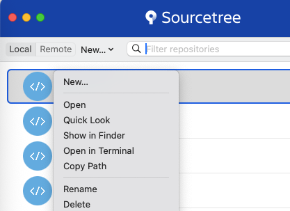

# SourceTree Copy Path (macOS)

<p align="center">
  
</p>

<p align="center">
  <strong>Copy Path</strong> sits in the bookmark list context menu, right after <em>Open in Terminal</em>.<br>
  One click copies the repository's absolute path.
</p>

<p align="center">
  <code>macOS 13+</code>&nbsp;·&nbsp;<code>SourceTree 4.2.x</code>&nbsp;·&nbsp;<code>universal binary</code>&nbsp;·&nbsp;<code>no runtime injection</code>
</p>

---

Adds a **Copy Path** item to the **bookmark list right-click menu** of SourceTree for macOS.
Clicking it puts the repository's absolute path on the clipboard — executed through SourceTree's
own custom-action runner, so the usual task window pops up and disappears, just like the built-in
custom actions.


## Why a patch is needed

SourceTree 4.2.x on macOS does not fill the bookmark-list context menu with custom actions:

- The Custom Actions submenu in the bookmark list is a **static nib menu**
  (its `delegate` is `nil`), and the app never populates it;
- `STRepoBrowserWindowController` (bookmark window) does **not** implement `performCustomAction:` —
  only `STGitWindowController` (repository window) does, so that menu has no handler at all.

Both the menu item and the click handler therefore have to come from outside the app.

## How it works

The installer makes exactly three changes to the app bundle:

| Change | Purpose |
|---|---|
| `Contents/Resources/stcopypath/libstcopypath.dylib` | Implementation library. Finds the bookmark outline view (`STRepoBrowserBookmarkOutlineView`), inserts **Copy Path** into the top-level menu right after *Open in Terminal*, swizzles `menuForEvent:` to remember the row that was actually right-clicked, and on click builds a lightweight repo object carrying `path` and calls the app's native `performCustomAction:forRepo:withSHAs:withFiles:window:` |
| `Contents/Info.plist` → `LSEnvironment.DYLD_INSERT_LIBRARIES` | Makes the app load the library at launch, so no resident injector / debugger is required |
| `codesign --force --deep --sign -` | Editing `Info.plist` invalidates the original signature. The ad-hoc re-sign also drops the Hardened Runtime flag, which is what allows `DYLD_INSERT_LIBRARIES` to take effect |

If the native call is unavailable for any reason, the library falls back to writing the path
straight to `NSPasteboard`.

## Requirements

- macOS 13+ (tested on macOS 15 with SourceTree 4.2.4 and 4.2.16)
- Xcode Command Line Tools (`codesign`; `build.sh` additionally needs `clang`)
- Write access to the app bundle (the app lives in your home-owned `/Applications`)

SIP does **not** need to be disabled: nothing attaches to the process.

## Install

```bash
./patch-sourcetree.sh install      # backup → install library → write Info.plist → ad-hoc re-sign
./patch-sourcetree.sh status       # inspect version / backup / library / LSEnvironment / signature
./patch-sourcetree.sh restore      # restore the original app from the backup
```

Then quit and relaunch SourceTree. The item appears at the top level of the bookmark right-click menu:

```
New…
────────
Open
Quick Look
Show in Finder
Open in Terminal
Copy Path          ← added
────────
Rename
Delete
…
```

Environment overrides:

```bash
SOURCETREE_APP=/path/to/Sourcetree.app
SOURCETREE_BACKUP=/path/to/backup
```

## Migrating to another Mac

```bash
scp -r stcopypath-sourcetree-<version> user@host:~/stcopypath
ssh user@host 'cd ~/stcopypath && ./patch-sourcetree.sh install'
```

The bundled library is a universal (x86_64 + arm64) binary, so the same archive works on Intel
and Apple Silicon machines.

## Rebuild the library

```bash
./build.sh     # requires Xcode Command Line Tools
```

## Rollback

```bash
./patch-sourcetree.sh restore
```

`install` keeps a full copy of the untouched app in `~/Sourcetree.app.backup` before it changes
anything.

## Known limitations

- **SourceTree auto-updates overwrite the app** and discard the patch. Re-run `install` after an
  update.
- The signature becomes ad-hoc: the Developer ID and team identifier are lost. The app still
  launches normally (the bundle carries no quarantine attribute).
- This targets the **bookmark list** only. It copies the repository path; for a file path, use the
  custom action inside a repository window.
- The patch depends on these class/menu names existing:
  `STRepoBrowserWindowController`, `STRepoBrowserBookmarkOutlineView`, `contextCustomActionsMenu`.

## Alternative: runtime injection (legacy)

`inject.sh` is the original approach: a `launchd` agent periodically `dlopen`s the same library into
a running SourceTree via `lldb`. It works, but requires the debugger to attach (debugging
restrictions disabled) and a resident job. The bundle patch above supersedes it; the script is kept
for reference only.

## Files

```
STCopyPath.m           library source (Objective-C)
libstcopypath.dylib    universal build (x86_64 + arm64)
patch-sourcetree.sh    install / restore / status
build.sh               rebuild the library
inject.sh              legacy runtime-injection helper
VERSION                version and verified builds
```

## Disclaimer

This modifies an application bundle you own. It is not affiliated with Atlassian. Review the script
before running it, keep the backup, and re-apply after updates.
